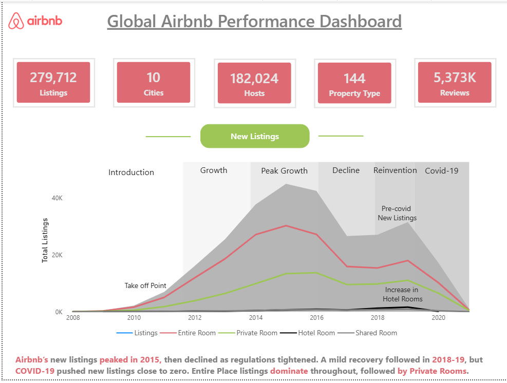
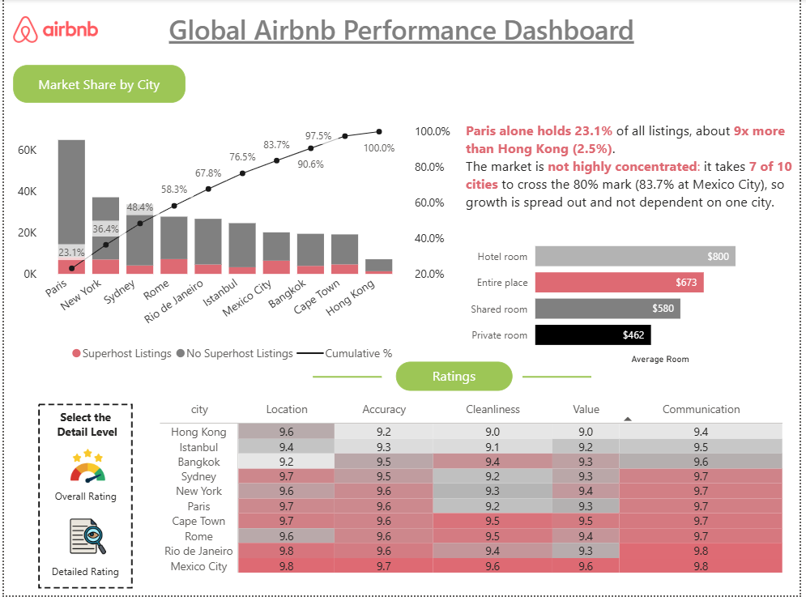
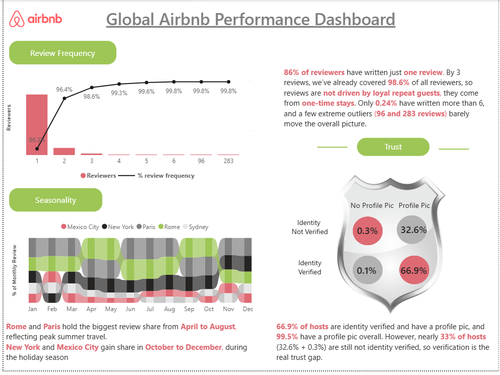

# Airbnb-Dashboard# 🏠 Global Airbnb Performance Dashboard

An interactive **Power BI** dashboard that analyses Airbnb listings, ratings, reviews and host trust across 10 major cities worldwide. It covers market growth, city-wise market share, guest ratings, review behaviour and seasonality.

## 📸 Dashboard Preview





---

## 🎯 Objective

To understand how the Airbnb market has grown, which cities lead, how guests rate their stays, and what reviews reveal about guest behaviour and host trust.

## 🛠️ Tools & Skills

- **Power BI Desktop** (data modelling, visuals, layout)
- **DAX** (Cumulative %, % of Monthly Review, Superhost counts, Avg Ratings)
- **Power Query** (data cleaning and modelling)
- **Data storytelling** (insight text boxes, visual hierarchy)

## 📂 Dataset

- Airbnb listings and reviews data for **9 cities**: Bangkok, Cape Town, Hong Kong, Istanbul, Mexico City, New York, Paris, Rome and Sydney.
- Tables: **Listings** and **Reviews**
- Source: [https://mavenanalytics.io/data-playground/airbnb-listings-reviews]
---

## 📊 Dashboard Pages

### 1. Overview: New Listings
- KPI cards: total listings, cities, hosts, property types and reviews
- Line chart of new listings by year, split by room type (Entire, Private, Hotel, Shared)

**Insight:** New listings peaked in 2015, then declined as regulations tightened. A mild recovery followed in 2018-19, but COVID-19 pushed new listings close to zero. Entire Place listings dominate throughout, followed by Private Rooms.

### 2. Ratings: Market Share and Quality
- Market share by city (Superhost vs non-Superhost listings, with cumulative %)
- Average room price by room type
- Overall rating by city, plus a detailed rating table (Location, Accuracy, Cleanliness, Value, Communication)

**Insight:** Paris alone holds **23.1%** of all listings, about 9x more than Hong Kong (2.5%). It takes 7 of 10 cities to cross the 80% mark, so growth is spread out and not dependent on one city.

### 3. Reviews: Frequency, Trust and Seasonality
- **Review Frequency:** Pareto-style chart of reviews per reviewer with cumulative %
- **Trust:** Host identity verification vs profile picture
- **Seasonality:** Ribbon chart of each city's share of monthly reviews

**Insights:**
- **86%** of reviewers wrote just one review, and **98.6%** wrote 3 or fewer. Reviews come from one-time stays, not loyal repeat guests.
- **66.9%** of hosts are identity verified and have a profile pic, and **99.5%** have a profile pic overall. However, nearly **33%** of hosts are not identity verified, so verification is the real trust gap.
- **Rome** and **Paris** hold the biggest review share from **April to August** (peak summer travel), while **New York** and **Mexico City** gain share in **October to December** (holiday season).

---

## 💡 Key Takeaways

1. The market is **spread across cities** and does not depend on one location.
2. Reviews come mostly from **one-time guests**, so there is room to convert first-time guests into repeat guests.
3. **Identity verification** is the biggest trust gap among hosts.
4. Demand is **seasonal and city-specific**, so pricing and promotions should be planned city by city.

## 🚀 How to Use

1. Download the Power BI file from [Google Drive](https://drive.google.com/file/d/1Y-AWLVkYKrNPVbhR1ONLi4nqJ9Pj1pM0/view?usp=sharing).
2. Open `Airbnb_Dashboard.pbix` in **Power BI Desktop**.

## 📁 Repository Structure

```
├── Airbnb_Dashboard.pbix
├── images/
│   ├── overview.png
│   ├── ratings.png
│   └── reviews.png
└── README.md
```
## 📬 Contact

**Riya Shahrawat**  
[LinkedIn](https://www.linkedin.com/in/riya-shahrawat-133208312) · [itsriyashahrawat@gmail.com]
